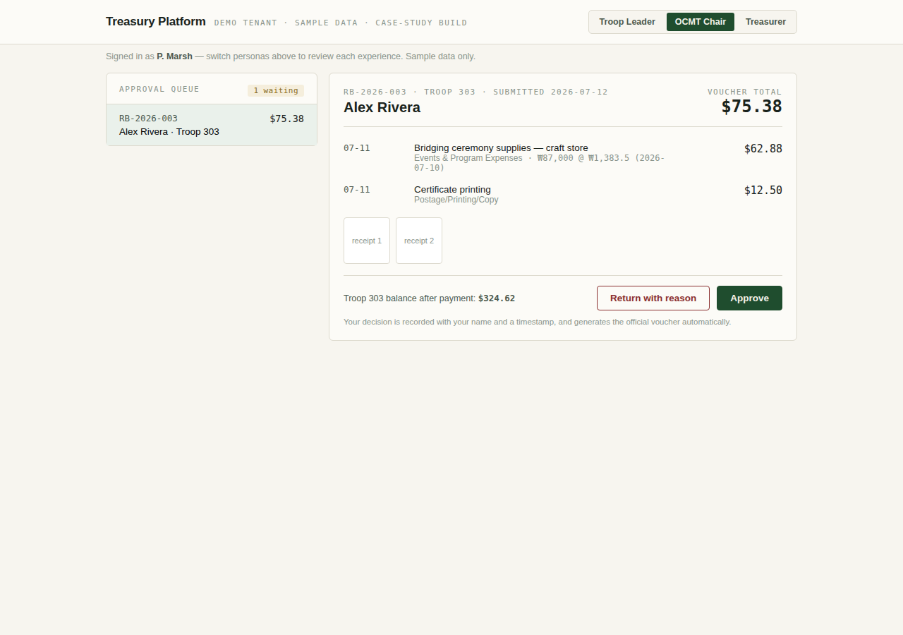

# Treasury Platform — Case Study

A multi-tenant treasury platform for volunteer-run organizations: reimbursement
submission and approval, automatic foreign-currency conversion at the rate most
favorable to the volunteer, check-register management, bank reconciliation, and
one-click generation of the official documents the parent organization requires.

**Pilot:** an overseas volunteer committee (7 troops, ~10 adult users) running a
full fiscal year on the system. **Stack:** Next.js (App Router), TypeScript
strict, Supabase (PostgreSQL + RLS + Storage), Vercel, Vitest + Playwright.

> This is a public case study. All screenshots use fictional sample data. The
> production repository is private; this repo documents the engineering process
> and architecture.

## Why it exists

Volunteer treasurers run real money on spreadsheets, manual currency math, and
paper forms. A single fiscal year at the pilot site surfaced every classic
failure: a check that cleared at a different amount than the ledger, a check
that never appeared on any statement, and a year-end close blocked on
reconciliation gaps. The platform turns those failure classes into database
constraints and automated flags.

## Engineering approach

Built as an integrated systems/software engineering lifecycle with full
traceability: Business Need → Stakeholder Requirement → System Requirement →
Software Requirement → Design Component → Source Code → Test Case → Acceptance
Evidence. Baselined Project Plan and Design documents, change records
(CR-001…), a living risk register, and a decision log (AD-01…).

Highlights:

- **Controls in the database, not the UI.** Five invariants enforced by
  triggers: no check without a recorded approval; approved records immutable
  (corrections are contra entries); voids require documentation; FX fields
  frozen at approval; reconciliation cannot close over unmatched lines.
- **Row-level security as the authorization model** — tenant → role → troop
  scoping on every table, verified by a CI negative-access suite (cross-troop
  reads, cross-tenant reads, and oversight-role write attempts must fail).
- **Volunteer-favorable FX policy as data.** A pure `resolveRate` function
  (weekend rule, market-holiday walk-back, configurable rate basis) with daily
  ingestion, failure alerting, and per-line audit fields: original amount, rate,
  rate date, source.
- **Documents are generated views over the database.** The official voucher
  PDF, the A–J year-end report, per-troop packets, and the audit package are
  reproducible artifacts hashed against their input rows.
- **Multi-tenancy and theming from day one.** Tenant-scoped schema and a
  token-driven theme layer: neutral default theme publicly; partner branding
  activates only as an authorized tenant theme with insignia as uploaded
  licensed assets.

## Screenshots (fictional data, neutral theme)

| | |
|---|---|
|  | Mobile submission with live KRW→USD conversion — volunteers never do currency math |
|  | One-tap approval with per-line FX audit trail and balance impact |
|  | Book vs. cleared balances and automatic control flags |
|  | Assist-first statement matcher; close blocked while lines are unmatched |

## Roadmap

Phase 1 (hardened spreadsheet bridge) → V1 pilot web app → V1.1 year-end
module → V2 multi-tenant productization with a regional oversight console.

## Provenance

Foundation patterns derive from SpendWise, a three-person capstone project
(auth scaffold, CRUD-slice convention, RLS isolation test harness), reused with
the written consent of the contributing co-author. All treasury-domain code is
original work.

---
© Jason V. Holmes. Case-study text and images may not be reproduced without
permission. Code snippets in this repository are MIT-licensed unless noted.
