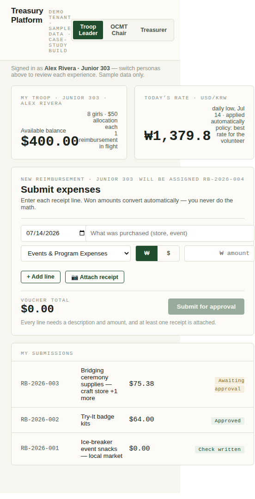
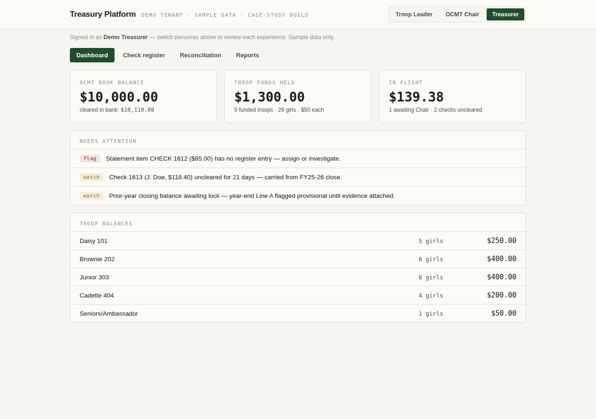
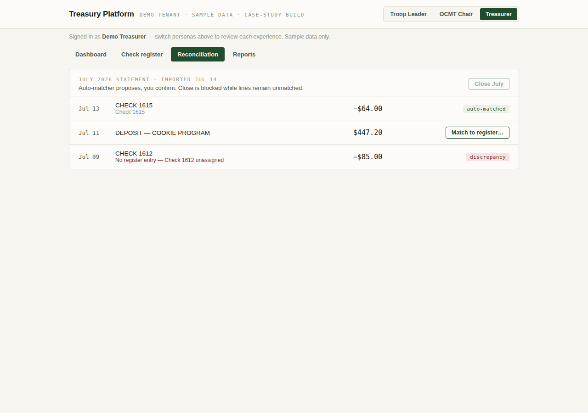

# Treasury Workflows — Architecture Case Study

Requirements and architecture for volunteer treasury workflows: reimbursement requests, approval controls, currency conversion, reconciliation and document generation.

## Current status

This is a public engineering case study, not evidence of a completed full-year web-platform pilot. Operational spreadsheet records informed the requirements. The earlier Next.js / Supabase / Vercel development repository was retired on 1 November 2026; current engineering work targets a Google Workspace operating system.

The successor's available engineering record still lists implementation and acceptance work as open. A completed end-to-end reimbursement, deployment acceptance and a full-year pilot have not been verified in the reviewed records. Operational workbook history must not be presented as acceptance evidence for the retired web platform or the successor application.

## Engineering approach

The documented traceability approach links business need, stakeholder and system requirements, software requirements, design, source, tests and acceptance evidence. Plans, architecture, change records and verification criteria describe the intended system; they do not establish that every control has been implemented or passed.

The earlier web-platform design proposed:

- Database controls requiring approval before check entry, preserving approved records, documenting voids and exceptions, retaining FX evidence, and preventing unreconciled closure.
- Tenant, role and troop access controls, with negative-access tests required for verification.
- Deterministic volunteer-favorable KRW-to-USD conversion with weekend and holiday fallback and per-line provenance.
- Reproducible voucher, reconciliation and year-end reporting outputs.
- Configurable tenant data and licensed branding rather than hard-coded organizational identity.

These are architecture requirements and verification targets. The current Google Workspace approach uses a different storage and control model; database-trigger and RLS claims from the former design must not be transferred to it.

## Illustrative screens

The images below use fictional data and illustrate the proposed workflow. They are not proof of production deployment or acceptance.

| Screen | Proposed workflow |
|---|---|
|  | Mobile reimbursement submission and FX evidence |
|  | Approval review and audit trail |
|  | Book and cleared balances with exception flags |
|  | Statement matching and reconciliation controls |

## Current direction

The November 2026 successor plan focuses on a request form, receipt photos, deterministic currency conversion, Treasurer review, Chair approval, check-number entry and a signed PDF. Implementation, verification and operational acceptance must be recorded before describing those capabilities as shipped. The previous multi-tenant commercialization roadmap is historical context, not the current delivery commitment.

## Provenance

Foundation patterns derive from **SpendWise**, the UMGC CMSC 495 capstone by **Leighton Tidwell, Jason Holmes and Eric Hill**. The earlier case study records consent for reuse; preserve the original attribution and applicable rights. Treasury-specific design and code contributions are distinct from the capstone baseline.

No private operational records, real financial details or youth records are published here. This independent case study does not imply organizational endorsement.

---
© Jason V. Holmes. Case-study text and images may not be reproduced without permission. Code snippets in this repository are MIT-licensed unless noted.
